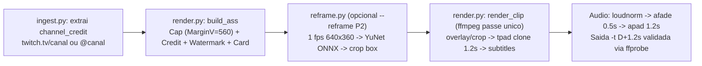

# creditos-encerramento Design

**Spec**: `/home/romulo/Projetos/planos_tlc-spec-driven/clipes-lives/features/clipes-lives/creditos-encerramento/spec.md`
**Status**: Approved

---

## Architecture Overview

### Exploração de Abordagens (Large/Complex)

1. **Abordagem A (Recomendada — Ponytail): Tudo em um único passe de `ffmpeg` + `libass` (`tpad=stop_mode=clone:stop_duration=1.2`, `loudnorm -> afade -> apad` e estilos ASS `Cap`, `Credit`, `Card`) + YuNet P2 via `onnxruntime`**
   - Custo de CPU adicional `< 0.4s` por clipe, `0 MB` de RAM extra, zero imagens PNG externas e zero segundo passe de concatenação de `outro.mp4` (CONSOLIDADO §2.2 e §2.3).
2. **Abordagem B: Renderizar um `outro.mp4` separado e concatenar via `ffmpeg concat`**
   - Rejeitada: exige dois encodes por clipe e pode gerar incompatibilidade de timebase/áudio na junção.
3. **Abordagem C: Instalar `opencv-python-headless` para rodar `cv2.FaceDetectorYN` no P2**
   - Rejeitada: `onnxruntime` já está instalado no container (via `faster-whisper`) e executa `face_detection_yunet_2023mar.onnx` em ~35 linhas de NumPy sem instalar OpenCV.



---

## Code Reuse Analysis

### Existing Components to Leverage

| Component | Location | How to Use |
| --------- | -------- | ---------- |
| `build_ass`, `render_clip`, `_ass_time`, `_ass_escape` | `clipes/render.py:80-290` | Estender `build_ass` com `channel_credit`, `part_index`, `part_total`, `outro_dur=1.2` e atualizar `vf_parts` e `-af` em `render_clip` |
| `IngestResult` e `ingest` | `clipes/models.py:33`, `clipes/ingest.py:376` | Adicionar `channel: str = ""` em `IngestResult` e extrair de `info.get("channel") or info.get("uploader")` ou da URL |
| `PartBadge` de `partes-por-assunto` | `clipes/render.py` | Coexiste no cabeçalho `[V4+ Styles]` do `.ass` (`PartBadge` em `y=490`, `Credit` em `y=600`, `Cap` em `MarginV=560`, `Card` em `y=960`) |

### Integration Points

| System | Integration Method |
| ------ | ------------------ |
| Feature `partes-por-assunto` (anterior na série) | `render.py` lê `clip.part_index` e `clip.part_total` já populados por `partes-por-assunto` para alternar o texto de `Style: Card` entre `"Parte k+1 →"` e `"Live completa: <channel_credit>"` |
| Modelo YuNet ONNX | Lido de `os.environ.get("CLIPES_YUNET_ONNX", "/opt/models/yunet/face_detection_yunet_2023mar.onnx")` |

---

## Components

### 1. Identificação do Canal (`clipes/models.py`, `clipes/ingest.py`)

- **Purpose**: Fornecer o identificador do canal e a string de crédito pronta (`twitch.tv/<canal>` ou `@<canal>`) para o renderizador e para a legenda.
- **Location**: `clipes/models.py`, `clipes/ingest.py`
- **Interfaces**:
  - `format_channel_credit(channel: str, url: str, extractor: str = "") -> str`
  - `IngestResult.channel: str = ""`

### 2. Gerador ASS com Safe Zones, Crédito e Cartão Final (`clipes/render.py`)

- **Purpose**: Produzir o arquivo `.ass` com `MarginV=560, MarginL=120, MarginR=200`, crédito inicial + marca d'água 40% e cartão final em `[D, D+1.2]`.
- **Location**: `clipes/render.py`
- **Interfaces**:
  - `SAFE_MARGIN_L = 120`, `SAFE_MARGIN_R = 200`, `SAFE_MARGIN_V = 560`, `OUTRO_DURATION = 1.2`
  - `build_ass(words, clip_start, clip_end, ass_path, width=1080, height=1920, words_per_cue=3, channel_credit="", part_index=1, part_total=1, outro_duration=1.2) -> int`
- **Dependencies**: nenhuma nova
- **Reuses**: `_ass_time`, `_ass_escape`

### 3. Cadeia FFmpeg de Encerramento sem Corte Seco (`clipes/render.py`)

- **Purpose**: Clonar o último quadro por `1.2s`, aplicar `loudnorm -> afade -> apad` e queimar todos os estilos ASS em um único passe.
- **Location**: `clipes/render.py`
- **Interfaces**:
  - `render_clip(clip, idx, words, url, out_dir, cache_dir, live_video_path=None, channel_credit="", reframe=False) -> Path`
  - Vídeo: `[bg_b][fg_s]overlay=(W-w)/2:(H-h)/2[v_base];[v_base]tpad=stop_mode=clone:stop_duration=1.2[v_pad];[v_pad]subtitles='{escaped_ass}'[v_out]`
  - Áudio: `-af "loudnorm=I=-14:TP=-1.5:LRA=11,afade=t=out:st={max(0.0, D - 0.5):.3f}:d=0.5,apad=pad_dur=1.2"`
  - Saída: `-t {D + 1.2:.3f}`

### 4. Reenquadramento Vertical Opcional com YuNet (P2, `clipes/reframe.py`)

- **Purpose**: Detectar posição mediana de rosto/webcam a `1 fps` (`640x360`) quando `--reframe` for solicitado.
- **Location**: `clipes/reframe.py`
- **Interfaces**:
  - `detect_speaker_crop(src_path: Path, start: float, duration: float, yunet_onnx: str | None = None) -> tuple[int, int, int, int] | None`
- **Dependencies**: `onnxruntime`, `numpy`, `subprocess` (`ffmpeg -vf fps=1,scale=640:360 -f rawvideo -pix_fmt bgr24 -`)

---

## Data Models

Estilos ASS em `clipes/render.py`:
```ini
Style: Cap,DejaVu Sans,72,&H00FFFFFF,&H0000FFFF,&H00000000,&H80000000,-1,0,0,0,100,100,0,0,1,5,2,2,120,200,560,1
Style: Credit,DejaVu Sans,38,&H00FFFFFF,&H00FFFFFF,&H00000000,&H80000000,-1,0,0,0,100,100,0,0,1,3,1,7,120,200,0,1
Style: PartBadge,DejaVu Sans,44,&H0000FFFF,&H0000FFFF,&H00000000,&H80000000,-1,0,0,0,100,100,1,0,1,4,2,8,120,200,490,1
Style: Card,DejaVu Sans,54,&H00FFFFFF,&H0000FFFF,&H00000000,&H80000000,-1,0,0,0,100,100,0,0,3,14,0,5,120,200,0,1
```

---

## Error Handling Strategy

| Error Scenario | Handling | User Impact |
| -------------- | -------- | ----------- |
| Clipe sem palavras (`selected == []` em `build_ass`) | Emite os eventos `Credit` e `Card` mesmo sem legendas de fala e retorna `len(events) >= 2` para que o `ffmpeg` aplique `subtitles` | Crédito e cartão final sempre aparecem |
| Falha no YuNet ONNX ou nenhum rosto detectado em `--reframe` | `detect_speaker_crop` retorna `None` e `render_clip` usa o layout 16:9 centralizado padrão | Renderização nunca falha por causa do detector de rosto |

---

## Risks & Concerns

| Concern | Location (file:line) | Impact | Mitigation |
| ------- | -------------------- | ------ | ---------- |
| `if n_subs > 0:` em `render.py:260` pulava o filtro `subtitles` quando não havia fala | `clipes/render.py:260` | Clipes sem fala perderiam o crédito e o cartão final | `build_ass` passa a retornar o total de eventos `Dialogue` (incluindo `Credit` e `Card`), então `n_subs > 0` é sempre verdadeiro |
| Normalização de silêncio se `apad` vier antes de `loudnorm` | `clipes/render.py:276` | O `loudnorm` inflaria o ganho do clipe para compensar os 1,2s de silêncio final (CONSOLIDADO §2.3) | Fixar a ordem `loudnorm=...,afade=...,apad=pad_dur=1.2` e cobrir com teste unitário/integração |

---

## Tech Decisions

| Decision | Choice | Rationale |
| -------- | ------ | --------- |
| Duração do encerramento | `1.2s` (`OUTRO_DURATION = 1.2`) | Mantém parte de `58.0s` + `1.2s` = `59.2s <= 60.0s` (CONSOLIDADO §2.1 e §2.3) |
| Execução do YuNet no P2 | `onnxruntime` sobre pipe `rawvideo` 1 fps do `ffmpeg` | Evita instalar `opencv-python-headless` na imagem e gasta `< 1s` por clipe |
