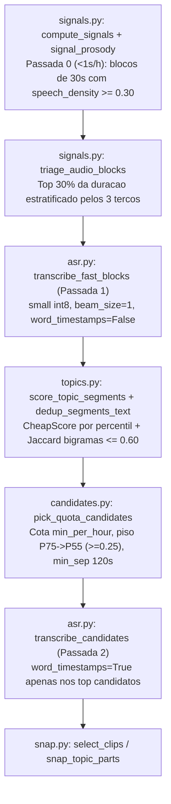

# deteccao-por-cota Design

**Spec**: `/home/romulo/Projetos/planos_tlc-spec-driven/clipes-lives/features/clipes-lives/deteccao-por-cota/spec.md`
**Status**: Approved

---

## Architecture Overview

### Exploração de Abordagens (Large/Complex)

1. **Abordagem A (Recomendada — Ponytail): Passada 0 prosódica em NumPy (`signals.py`) + Passada 1 `faster-whisper small` (`beam_size=1, word_timestamps=False`) nos top 30% blocos (`asr.py`) + Segmentação e `CheapScore` por percentil (`topics.py`/`candidates.py`) + Passada 2 (`word_timestamps=True`) apenas nos escolhidos**
   - Reaproveita o modelo `small` já assado no `Dockerfile`, os módulos `signals.py`, `asr.py`, `topics.py` (criado em `partes-por-assunto`) e `candidates.py`, sem adicionar nenhum pacote pip nem modelo novo. Custo de ASR cai de ~29 min/h (transcrever tudo em beam 5) para ~6–9 min/h.
2. **Abordagem B: Baixar Whisper `tiny` ou `base` para transcrever 100% do áudio na Passada 1**
   - Rejeitada: exige assar mais um modelo no `Dockerfile` e o `tiny` tem WER de ~24% em pt-BR (CONSOLIDADO §5), degradando a detecção de fronteiras de assunto e palavras-chave.
3. **Abordagem C: Transcrever 100% do vídeo no `small` e pedir nota ao LLM para cada bloco de 60s**
   - Rejeitada: ~88 min de ASR + ~30 min de LLM para uma VOD de 3h no Ryzen 5 5500U, inviabilizando alto volume.



---

## Code Reuse Analysis

### Existing Components to Leverage

| Component | Location | How to Use |
| --------- | -------- | ---------- |
| `robust_percentile_norm`, `compute_rms_db`, `SILENCE_DB`, `FPS_RMS` | `clipes/signals.py:17,18,64,87` | Reusar para normalizar `signal_prosody` e todas as features de `CheapScore` por percentil dentro do próprio vídeo |
| `merge_windows`, `load_audio_slice`, `transcribe_candidates` | `clipes/asr.py:17,32,50` | Reusar em `transcribe_fast_blocks` (Passada 1) e manter `transcribe_candidates` como Passada 2 com `word_timestamps=True` |
| `words_to_sentences`, `segment_topics` | `clipes/topics.py` (de `partes-por-assunto`) | Reusar sobre os segmentos da Passada 1 para delimitar unidades de assunto antes de calcular `CheapScore` |
| `TITLE_KEYWORDS` | `clipes/render.py:13` | Reusar como parte do léxico de reação/história em `CheapScore` |
| `evaluate_clips` | `clipes/eval.py:14` | Estender com `evaluate_quota_calibration` (`precision_at_k`, `recall_at_k`) |

### Integration Points

| System | Integration Method |
| ------ | ------------------ |
| `partes-por-assunto` (`clipes/topics.py` e `clipes/snap.py`) | `pick_quota_candidates` devolve objetos `CandidatePeak` com `topic_start` e `topic_end` preenchidos, que entram diretamente em `transcribe_candidates` (Passada 2) e `select_clips` |
| `legenda-hashtags` (`clipes/llm.py`) | Após `select_clips`, os clipes selecionados pela cota recebem `enrich_clips_with_llm` exatamente como os clipes de pico |

---

## Components

### 1. Sinal de Prosódia 1 Hz e Triagem de Blocos (`clipes/signals.py`)

- **Purpose**: Detectar fala expressiva e mudanças de cadência mesmo com compressor de áudio (`±2 dB`) e selecionar os blocos de áudio para a Passada 1 respeitando o orçamento e os 3 terços do vídeo.
- **Location**: `clipes/signals.py`
- **Interfaces**:
  - `signal_prosody(rms_db: np.ndarray, n: int) -> np.ndarray`
  - `triage_audio_blocks(bundle: SignalBundle, block_s: float = 30.0, hop_s: float = 15.0, budget_ratio: float = 0.30, min_speech_density: float = 0.30) -> list[tuple[float, float, float]]`
- **Dependencies**: `numpy`, `scipy.ndimage`
- **Reuses**: `robust_percentile_norm`, `FPS_RMS`, `SILENCE_DB`

### 2. ASR em Duas Passadas (`clipes/asr.py`)

- **Purpose**: Executar transcrição rápida de triagem (`beam_size=1, word_timestamps=False`) nos blocos da Passada 0 e transcrição fina (`word_timestamps=True`) apenas nos candidatos aprovados.
- **Location**: `clipes/asr.py`
- **Interfaces**:
  - `transcribe_fast_blocks(audio_path: Path, blocks: list[tuple[float, float, float]], cache_dir: Path, model_size: str | None = None, cpu_threads: int | None = None) -> list[Word]`
  - `transcribe_candidates(..., beam_size: int = 1)` (parametrizável entre `beam_size=1` e `5` conforme medição M2)
- **Dependencies**: `faster_whisper`
- **Reuses**: `merge_windows`, `load_audio_slice`

### 3. Pontuação `CheapScore` e Deduplicação Textual (`clipes/topics.py`)

- **Purpose**: Pontuar cada unidade de assunto de `25–180s` em `[0, 1]` por percentil do vídeo e eliminar assuntos repetidos.
- **Location**: `clipes/topics.py`
- **Interfaces**:
  - `score_topic_segments(segments: list[TopicSegment], bundle: SignalBundle) -> list[TopicSegment]`
    - Calcula por segmento: `hook` (`?`/`!` nas 2 primeiras frases), `story_kw` (marcadores de narrativa/risada menos penalidade de leitura de sub/donate `"obrigado pelo sub"`, `"valeu pelos bits"`), `pace` (taxa de palavras/s na faixa `2.0..4.2`), `prosody` (média de `bundle.scores["prosody"]` e `loudness`) e `ext` (`chat`/`heatmap` se ativos), normalizados via `robust_percentile_norm`.
  - `dedup_segments_text(segments: list[TopicSegment], max_jaccard: float = 0.60) -> list[TopicSegment]`
- **Dependencies**: `numpy`, `re`
- **Reuses**: `robust_percentile_norm`, `TITLE_KEYWORDS`

### 4. Seletor por Cota, Modo Piso e Diversificação (`clipes/candidates.py`)

- **Purpose**: Garantir `K = clamp(ceil(min_per_hour * dur_h), 1, max_clips)` candidatos bem distribuídos e acima do piso anti-lixo.
- **Location**: `clipes/candidates.py`
- **Interfaces**:
  - `pick_quota_candidates(bundle: SignalBundle, topic_segments: list[TopicSegment], max_clips: int = 8, min_per_hour: float = 3.0, min_separation: float = 120.0, floor_percentile: float = 75.0, min_abs_score: float = 0.25) -> tuple[list[CandidatePeak], bool]`
- **Dependencies**: `numpy`, `math`
- **Reuses**: `pick_candidate_peaks`, `CandidatePeak`

### 5. Calibração `precision@K` (`clipes/eval.py`, `tests/fixtures/calib_labels.json`)

- **Purpose**: Avaliar objetivamente a qualidade do ranking sem GPU sobre momentos rotulados e contra o heatmap oculto.
- **Location**: `clipes/eval.py`, `tests/fixtures/calib_labels.json`
- **Interfaces**:
  - `evaluate_quota_calibration(selected: list[CandidatePeak], labels: list[dict[str, Any]], k: int = 8) -> dict[str, float]`

---

## Data Models

Estrutura de `tests/fixtures/calib_labels.json`:
```json
{
  "video_id": "UBv07VGeD24",
  "duration": 9659.0,
  "moments": [
    {"start": 305.29, "end": 337.25, "label": 1, "note": "entrada convidado"},
    {"start": 1722.27, "end": 1761.35, "label": 1, "note": "brincadeira morar perto"},
    {"start": 900.0, "end": 945.0, "label": 0, "note": "conversa neutra / leitura"}
  ]
}
```

---

## Error Handling Strategy

| Error Scenario | Handling | User Impact |
| -------------- | -------- | ----------- |
| Vídeo sem fala (ex.: live de música 24/7) | `triage_audio_blocks` retorna `[]` (`speech_density < 0.30`) e `pick_quota_candidates` retorna `([], False)` | Pipeline encerra com código `0` e `clips: []` sem gastar CPU com ASR |
| Poucos segmentos superam `P75` em live calma | `pick_quota_candidates` relaxa o percentil para `P65` e `P55` (`floor_mode = True`), parando em `min_abs_score = 0.25` | Preenche a cota com os melhores momentos reais sem aprovar silêncio |

---

## Risks & Concerns

| Concern | Location (file:line) | Impact | Mitigation |
| ------- | -------------------- | ------ | ---------- |
| `min_scale=8.0` em `signals.py:143` esmaga variações de voz comprimida (`±2 dB`) | `clipes/signals.py:143` | Em podcasts com limiter no OBS, `signal_loudness` fica quase zero no vídeo inteiro | Adicionar `signal_prosody` com `min_scale` adaptativo baseado no IQR da voz ativa (`max(1.5, 1.5 * iqr)`) |
| Viés circular ao calibrar pesos usando apenas os 8 clipes de `docs/teste-real.md` | `tests/fixtures/calib_labels.json` | Os 8 clipes do teste real vieram de picos, favorecendo `loudness` (CONSOLIDADO §5) | Incluir em `calib_labels.json` tanto momentos de conversa sem grito quanto janelas negativas reais, e medir correlação ocultando o `heatmap` |
| Estouro de tempo de CPU se `--asr-budget-ratio` for alto em VOD de 4h | `clipes/asr.py` | Passada 1 poderia passar de 25 min | Limitar a Passada 1 por `min(budget_ratio * duration, max_asr_audio_s)` (`padrão max 3600s` de áudio = ~17 min de CPU em `beam=1`) |

---

## Tech Decisions

| Decision | Choice | Rationale |
| -------- | ------ | --------- |
| ASR da Passada 1 | `faster-whisper small` `int8` com `beam_size=1, word_timestamps=False` | Já está na imagem Docker, roda a `~0.29 xRT` e evita o WER de 24% do `tiny` em pt-BR (CONSOLIDADO §5) |
| Estratégia de seleção padrão | `--mode auto` (picos fortes P90 + complemento por cota de segmentos) | Nunca perde um pico explosivo óbvio e nunca devolve poucos clipes quando a live é conversada |
