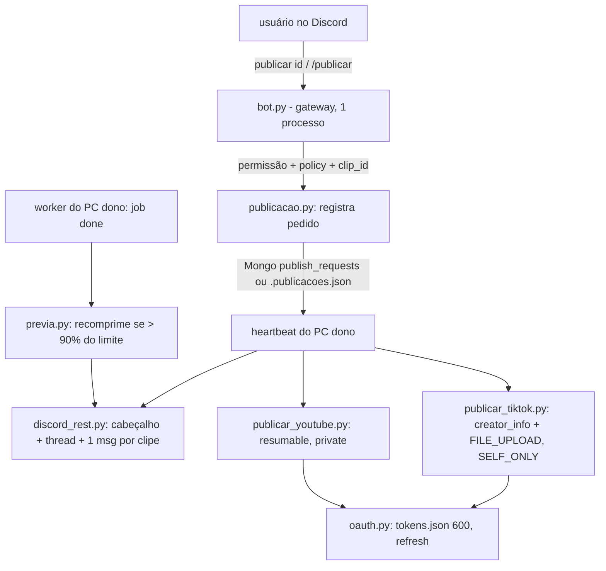

# Onda C Design

**Spec**: `features/clipes-lives/discord-publicacao/issues/onda-c-discord-publicar/spec.md`
**Pesquisa**: `pesquisa/ondas-ABC/relatorios/A-argon.md` seções 1.4, 1.5, 5 e 6
**Depende de**: Onda A (`clip_id`, `description_long`, `hook_top`) e Onda B (`coord.py`, heartbeat, `commands`)
**Status**: Draft

---

## Architecture Overview

O arquivo do clipe só existe no PC que o renderizou. Então: a prévia é enviada por REST pelo próprio PC dono; um único processo `bot` (gateway do `discord.py`) recebe os comandos e grava o pedido; o worker do PC dono executa a publicação. Sem Mongo (1 PC), o bot executa direto.



---

## Code Reuse Analysis

### Existing Components to Leverage

| Component | Location | How to Use |
| --------- | -------- | ---------- |
| `clips.json` por rodada | `clipes/cli.py:433-453` | Fonte do `clip_id`, título, descrições, arquivo |
| `load_policy`, `ChannelPolicy.permits`, `ready_at` | `clipes/monitor.py:60-80`, `:779` | Trava de publicação |
| `Coord` e heartbeat | `clipes/coord.py` (Onda B) | Coleção `publish_requests` e consulta no heartbeat |
| Padrão de `urlopen` injetável | `clipes/llm.py:289`, `clipes/cloud_llm.py` (Onda A) | Clientes REST de Discord, Google e TikTok testáveis sem rede |
| `subprocess` + ffmpeg | `clipes/render.py:401-422` | Recompressão da prévia |
| `sanitize_id` | `clipes/ingest.py:35` | Nomes de arquivo de prévia |

### Integration Points

| System | Integration Method |
| ------ | ------------------ |
| Discord REST v10 | `POST /channels/{id}/messages` (multipart com `payload_json` + `files[0]`), `POST /channels/{id}/messages/{msg}/threads`; header `Authorization: Bot <token>`; 429 → `retry_after` |
| Discord gateway | `discord.py>=2.4,<3`: `Intents.default()` + `message_content=True`, `app_commands` sincronizados na guild (`copy_global_to` + `tree.sync(guild=...)`) |
| YouTube Data API v3 | `POST https://oauth2.googleapis.com/token` (refresh) → `POST https://www.googleapis.com/upload/youtube/v3/videos?uploadType=resumable&part=snippet,status` → `PUT <Location>` |
| TikTok Content Posting API v2 | `POST /v2/oauth/token/` → `POST /v2/post/publish/creator_info/query/` → `POST /v2/post/publish/video/init/` → `PUT upload_url` com `Content-Range` → `POST /v2/post/publish/status/fetch/` |
| Segredos | `segredos.env` (env: `DISCORD_BOT_TOKEN`, `DISCORD_CHANNEL_ID`, `DISCORD_GUILD_ID`, `DISCORD_ALLOWED_USER_IDS`, client ids/secrets) + `tokens.json` (refresh tokens, gravável) em `~/.config/clipes-lives` montado em `/config` |

---

## Components

| Módulo (novo) | Interface principal | Notas |
| ------------- | ------------------- | ----- |
| `clipes/previa.py` | `preview_for_discord(src, duration, cache_dir, limit_mb, run=subprocess.run) -> Path \| None` | Original se couber; senão 720x1280 com bitrate da fórmula; `None` se nem 400 kbps couber |
| `clipes/discord_rest.py` | `DiscordRest(token, urlopen, sleep).post(channel_id, content, file=None) -> dict`, `.thread_from(channel_id, message_id, name) -> str` | Multipart com stdlib (`uuid` boundary); 429 até 3x; token nunca em exceção |
| `clipes/oauth.py` | `load_tokens()`, `save_tokens()` (atômico, 600), `refresh_google(...)`, `refresh_tiktok(...)` (regrava refresh novo), `auth_flow(plataforma, open_url, serve)` | `state` aleatório (`secrets.token_urlsafe`) |
| `clipes/publicar_youtube.py` | `publish(mp4, title, description, token, urlopen) -> dict` | `privacyStatus="private"` literal; até 3 retomadas |
| `clipes/publicar_tiktok.py` | `publish(mp4, caption, token, urlopen, sleep) -> dict` | `SELF_ONLY` literal; `creator_info` antes |
| `clipes/publicacao.py` | `find_clip(out_root, clip_id)`, `request(store, clip_id, user_id, now) -> str`, `run_pending(store, worker_id, ...)`, `quota_ok(plataforma, now)` | Store = `Coord` (Mongo) ou `LocalStore` (`OUT_DIR/.publicacoes.json`); chave única `(clip_id, plataforma)` |
| `clipes/bot.py` | `make_bot(store, allowed_ids, channel_id, guild_id)`, `main()` | Comandos: mensagem `publicar <id>`, `/publicar`, `/listar` |

Alterados: `clipes/monitor.py` (prévia após job `done`; `run_pending` no heartbeat), `clipes/__main__.py` (subcomandos `bot`, `auth`), `Dockerfile` (`discord.py`), `docker-compose.yml` (serviço `bot`, volume `/config`, env), `README.md` (portais e auditoria).

---

## Data Models

```js
// publish_requests (Mongo) ou .publicacoes.json (local), exemplo fictício
{ _id: "UBv07VGeD24_c03:youtube", clip_id: "UBv07VGeD24_c03", plataforma: "youtube" | "tiktok",
  owner: "w-3f9a1b2c4d5e", pedido_por: "<discord user id>", status: "pending" | "ok" | "adiado" |
  "erro_auth" | "erro_arquivo" | "erro_conta" | "erro", resultado: { video_id | publish_id, privacidade: "private" },
  thread_id: "...", criado_em: ISODate, concluido_em: ISODate | null }
// clips.json, por clipe (campos novos desta onda)
{ "discord": { "thread_id": "...", "message_id": "..." }, "publicacoes": [ { "plataforma": "youtube", "id": "...", "privacidade": "private" } ] }
// /config/tokens.json (fora do git, 600)
{ "youtube": { "refresh_token": "***" }, "tiktok": { "refresh_token": "***", "open_id": "***" } }
```

---

## Error Handling Strategy

| Error Scenario | Handling | User Impact |
| -------------- | -------- | ----------- |
| Discord 429 | Espera `retry_after`, até 3x; depois `discord_error` no job | Prévia ausente; worker segue |
| Arquivo maior que o limite | Prévia 720x1280; se não couber, mensagem sem anexo | Texto com caminho local |
| 401 nas APIs | 1 refresh; falha → `erro_auth` | `refaca clipes auth <plataforma>` |
| TikTok conta pública/não auditado | `erro_conta` | `deixe a conta do TikTok como privada` |
| Upload YouTube cai | Retoma pela sessão, até 3x | Nenhum ou `erro` |
| PC dono offline | Pedido fica `pending` | `PC <alias> offline; pedido fica na fila` |
| Cota diária | `adiado` | `cota diaria atingida (<plataforma>)` |

---

## Risks & Concerns

| Concern | Location (file:line) | Impact | Mitigation |
| ------- | -------------------- | ------ | ---------- |
| Publicar sem querer durante o desenvolvimento | `clipes/publicar_*.py` | Post real | Testes só com `urlopen` falso; nenhum token no ambiente de teste; privacidade literal no código; publicação real só pelo usuário |
| Intent Message Content desligado no portal | `clipes/bot.py` | Comando por texto não chega | Slash `/publicar` cobre; README manda ligar o intent |
| Refresh token do Google expira em 7 dias em "Testing" | `clipes/oauth.py` | `erro_auth` semanal | README: publicar a tela de consentimento como "In production" |
| Refresh token rotacionado do TikTok perdido | `clipes/oauth.py` | Perde acesso | Regravar a cada refresh com escrita atômica |
| Token em log/exceção/mensagem | todos os clientes REST | Vazamento | Mensagens de erro só com status HTTP e código da API; teste procura o token falso nas saídas |
| Conteúdo reutilizado (YPP, For You) e Content ID em Short > 60 s | - | Bloqueio ou alcance baixo | Publicação manual por clipe; partes <= 59,2 s; crédito, gancho e descrição contextual; `policy.json` com `delay_h` |
| Auditorias TikTok/YouTube | portais | Fica privado | README com o que cada auditoria pede (relatório A seção 6.2); público exige nova AD |
| `monitor.py` acumulando responsabilidades | `clipes/monitor.py` | Colisão de tasks | Só 2 pontos de chamada nele; lógica em módulos novos |

---

## Tech Decisions (only non-obvious ones)

| Decision | Choice | Rationale |
| -------- | ------ | --------- |
| Clientes Google/TikTok | REST com `urllib`, sem `google-api-python-client` | 3-4 chamadas por plataforma; imagem menor |
| Envio de prévia | REST pelo PC dono, não pelo gateway | Arquivo é local; gateway roda num PC só |
| Privacidade | Literais `private`/`SELF_ONLY`, sem env | Nenhuma variável liga público por engano; público = nova AD |
| Projeto-level | AD-009 (publicação por comando, privada) em `STATE.md` | Reverte AD-006 |
