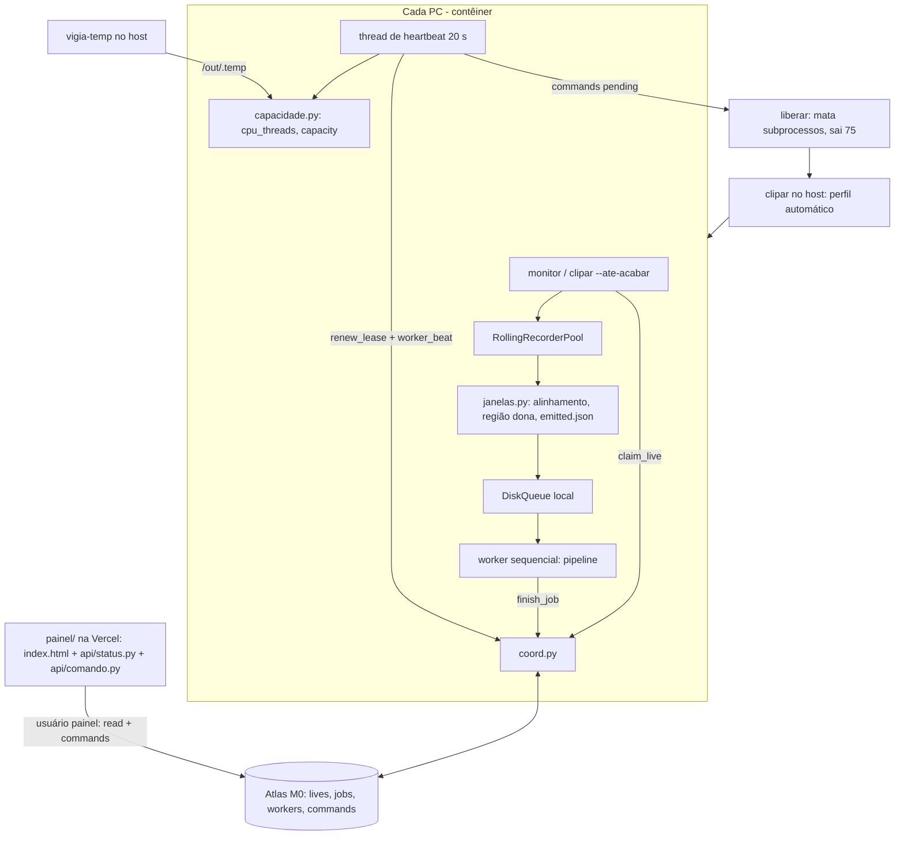

# Onda B Design

**Spec**: `features/clipes-lives/fila-distribuida/issues/onda-b-fila-mongo-dashboard/spec.md`
**Pesquisa**: `pesquisa/ondas-ABC/relatorios/B-opus.md` (fonte das decisões de lease, janelas, vigia e painel)
**Status**: Draft

---

## Architecture Overview

O Mongo coordena, não transporta vídeo: decide qual PC grava cada live (lease), guarda o estado dos jobs e dos PCs e leva comandos do painel aos PCs. O painel roda na Vercel (decisão do usuário, rodada 2) e lê o Mongo com um usuário de permissão mínima. O vídeo, a `DiskQueue` e o worker sequencial continuam locais em cada PC. Sem `CLIPES_MONGO_URI`, tudo roda como hoje.



---

## Code Reuse Analysis

### Existing Components to Leverage

| Component | Location | How to Use |
| --------- | -------- | ---------- |
| `DiskQueue`, `run_worker_step`, `recover_orphans` | `clipes/monitor.py:650-787` | Continua a fila local; ganha ganchos de `coord` ao reivindicar/concluir |
| `RollingRecorderPool`, `freeze_and_concat`, `hold`, `cleanup`, `enforce_cap` | `clipes/monitor.py:375-547` | Gravador da live contínua (1 canal) |
| `capture_job` (montagem de `job_dir`, `chat.json`, `meta.json`) | `clipes/monitor.py:555-636` | Mesma montagem para janelas da live contínua |
| `_helix_logins` | `clipes/monitor.py:88-112` | Guardar também o `id` do stream como `stream_id` |
| `probe_metadata` / `is_live` | `clipes/ingest.py:68`, `:486` | Sinal de fim de live e `stream_id` sem Helix |
| `ingest_local`, `run_local_pipeline` | `clipes/ingest.py:426`, `clipes/monitor.py:721` | Processar cada janela |
| `_lock_worker` (flock) | `clipes/monitor.py:790` | Modo sem Mongo |
| Laço do `vigia-temp` | `vigia-temp:7-17` | Trocar só a leitura do sensor e gravar `.temp` |

### Integration Points

| System | Integration Method |
| ------ | ------------------ |
| MongoDB Atlas M0 | `pymongo.MongoClient(CLIPES_MONGO_URI, maxPoolSize=5, serverSelectionTimeoutMS=5000)`; client injetado (`mongomock.MongoClient()` em teste, nunca `mongomock.patch`) |
| Host → contêiner | `clipar` exporta `CLIPES_CPUS`/`CLIPES_MEM`; `docker-compose.yml` usa `cpus: ${CLIPES_CPUS}`, `mem_limit: ${CLIPES_MEM:-8g}` |
| Vigia → contêiner | Arquivo `$OUT_DIR/.temp` (montado em `/out/.temp`) |
| Painel remoto | Vercel (deploy feito pelo usuário): funções Python em `painel/api/*.py` com `pymongo`; env da Vercel `PAINEL_MONGO_URI` (usuário `painel`) e `PAINEL_SENHA` |
| Comando liberar | `commands` no Mongo → heartbeat do monitor → sai 75 → `clipar` reinicia após `CLIPES_RESTART_S` |

---

## Components

### capacidade (novo)

- **Location**: `clipes/capacidade.py`
- **Interfaces**: `cpu_threads() -> int`; `capacity(out_dir: Path, *, sysfs="/sys", proc="/proc", run=subprocess.run) -> dict`; `worker_id(out_dir: Path) -> str`.
- **Reuses**: stdlib (`shutil.disk_usage`, `os.cpu_count`, `uuid`).

### janelas (novo, puro)

- **Location**: `clipes/janelas.py`
- **Interfaces**: `window_end(t: float, step: int) -> int`; `owns(center: float, s: float, e: float, step: int, pad: float, last: bool) -> bool`; `filter_emitted(clips_abs: list[tuple[float, float]], emitted_path: Path) -> list[bool]` (grava os aceitos).

### coord (novo)

- **Location**: `clipes/coord.py`
- **Interfaces** (classe `Coord(db, worker_id, *, now=time.time, lease_s=90)`):
  - `ensure_live(live_id, **meta)`, `claim_live(live_id) -> bool`, `renew(live_id) -> bool`, `release(live_id, ended: bool)`
  - `add_job(job_id, live_id, window, priority) -> bool`, `start_job(job_id) -> bool`, `finish_job(job_id, status, result) -> bool`
  - `beat(alias, capacity: dict, job_atual: str | None)`
  - `mask_uri(uri) -> str` (função de módulo)
- **Reuses**: nenhum código local; operadores Mongo listados no relatório B seção 1.4.

### painel (novo, para a Vercel)

- **Location**: `painel/index.html`, `painel/api/status.py`, `painel/api/comando.py`, `painel/requirements.txt` (`pymongo`), `painel/vercel.json`; lógica testável em `painel/api/_nucleo.py` (`status(db, now)`, `criar_comando(db, worker_id, confirmar, now)`, `autorizado(header, senha)`).
- **Interfaces**: cada função exporta `class handler(BaseHTTPRequestHandler)` (formato de função Python da Vercel; conferir a doc oficial na hora de implementar), que só lê env, abre o client e chama `_nucleo`.
- **Reuses**: `secrets.compare_digest`, `html.escape` (no JS via `textContent`), padrões de `coord.py`.
- **Front**: `index.html` sem framework; `fetch('/api/status')` a cada 10 s; botão "liberar recursos" por PC com `confirm()` e campo de texto `LIBERAR`.

### comandos e perfil (no monitor/clipar)

- `Coord.pending_command() -> dict | None`, `Coord.mark_command(id, status)` em `coord.py`.
- `monitor.py`: no heartbeat, comando `liberar` → `pool.stop_all()`, encerrar `llama-server`/ffmpeg filhos, marcar `feito`, `sys.exit(75)`.
- `clipar`: laço `while` que repete o `docker compose run` quando o código for 75, com `sleep ${CLIPES_RESTART_S:-60}`.
- `clipes/perfil.py`: `medir(job_dir, pipeline) -> dict` grava `.perfil.json`; `max_lives(out_dir, cpus) -> int`; subcomando `python -m clipes bench-live <job_dir>`.

### Alterações em arquivos existentes

| Arquivo | Mudança |
| ------- | ------- |
| `vigia-temp` | `SYSFS_ROOT`, hwmon por nome, `sem-sensor`, `.temp`, `--check` |
| `entrypoint.sh` | `export OMP_NUM_THREADS=OPENBLAS_NUM_THREADS=` de `CLIPES_CPU_THREADS` ou `cpu.max` |
| `Dockerfile` | Camada final `pip install "pymongo>=4.8" "mongomock>=4.3"` |
| `clipar` | Perfil automático, aviso `sem-sensor`, reinício no código 75 |
| `docker-compose.yml` | `mem_limit: ${CLIPES_MEM:-8g}`, repasse de `CLIPES_MONGO_URI`, `CLIPES_ALIAS`, `CLIPES_LEASE_S`, `CLIPES_BEAT_S`, `CLIPES_MIN_FREE_GB` |
| `clipes/asr.py`, `clipes/topics.py`, `clipes/llm.py` | Default de threads = `cpu_threads()` |
| `clipes/monitor.py` | Backend Mongo/disco, claim de live (respeitando `max_lives`), heartbeat, comando liberar, laço `follow_live`, `--follow` |
| `clipes/cli.py` | `--ate-acabar` delega ao `follow_live` |

---

## Data Models

```js
// lives (exemplo fictício)
{ _id: "twitch:canal_exemplo:123456789", channel: "canal_exemplo", platform: "twitch",
  stream_id: "123456789", status: "live" | "ended", owner: "w-3f9a1b2c4d5e" | null,
  lease_until: ISODate, created_at: ISODate, ended_at: ISODate | null }
// jobs
{ _id: "twitch:canal_exemplo:123456789:1763416800", live_id: "...", window_start: 1763416200,
  window_end: 1763416800, status: "pending" | "processing" | "done" | "rejected" | "lost" | "failed",
  owner: "w-...", lease_until: ISODate, attempts: 1, priority: 4.2,
  result: { clips: 3, score: 0.81, output_dir: "<relativo a OUT_DIR>" }, updated_at: ISODate }
// workers
{ _id: "w-3f9a1b2c4d5e", alias: "PC-1", heartbeat_at: ISODate,
  capacity: { cpus: 3, ram_gb: 2.6, disco_livre_gb: 15.1, temp_c: 78 | null, gpu: null, score: 3 },
  job_atual: "..." | null, max_lives: 1, razao: 0.33, history: [ { t, cpu_pct, temp_c } ]  // $slice -180
}
// commands
{ _id: ObjectId, worker_id: "w-...", acao: "liberar", status: "pending" | "executando" | "feito" | "rejeitado",
  criado_em: ISODate, executado_em: ISODate | null }
```

Usuários do banco (criados pelo usuário no Atlas): `workers` readWrite em `lives`, `jobs`, `workers`, `commands`; `painel` read em `lives`, `jobs`, `workers` e insert/update em `commands` (role customizada).

Índices: `jobs {status: 1, priority: -1}`, `lives {status: 1, lease_until: 1}`, `commands {worker_id: 1, status: 1}` (criados por `Coord.ensure_indexes()`; os `_id` já são únicos).

---

## Error Handling Strategy

| Error Scenario | Handling | User Impact |
| -------------- | -------- | ----------- |
| Mongo fora do ar | `ServerSelectionTimeoutError` → modo local + retry a cada 60 s | Painel mostra PC offline; clipes continuam |
| Lease perdida | Parar gravador da live, não concluir jobs dela | Log `[fila] lease perdida` |
| `DuplicateKeyError` em `lives`/`jobs` | Tratado como "já existe" | Nenhum |
| `nvidia-smi` ausente | `gpu=None` | Painel mostra `-` |
| `/out/.temp` ausente ou `sem-sensor` | `temp_c=None` | Painel mostra `n/d` |
| Disco < piso | Pula janela | Log `[live] janela pulada: disco` + campo no heartbeat |

---

## Risks & Concerns

| Concern | Location (file:line) | Impact | Mitigation |
| ------- | -------------------- | ------ | ---------- |
| Vigia nunca funcionou (lê 0 °C) | `vigia-temp:10` | Desligamentos sob carga | T1 primeiro; teste com sysfs falso |
| Tctl ocioso ~79 °C e `MAX=85` | `vigia-temp:4` | Pausas frequentes e janelas `lost` | Limiar em env; pergunta ao usuário |
| Sobre-assinatura de threads | `Dockerfile:15-16`, `clipes/asr.py:64,174`, `clipes/llm.py:228`, `clipes/topics.py:86` | 6 threads numa cota de 3 | `cpu_threads()` único + `entrypoint.sh` |
| `mem_limit: 8g` > RAM livre do piso | `docker-compose.yml:6` | OOM do host | `CLIPES_MEM` automático |
| `monitor.py` com 954 linhas e muitas responsabilidades | `clipes/monitor.py` | Tasks colidem | Toda task em `monitor.py` é serial; lógica nova em módulos novos (`coord`, `janelas`, `capacidade`) |
| `mongomock` sem mantenedor; `$or`+`$lt`+`$push/$slice` não verificados | `tests/test_coord.py` | Fake diverge do real | 1º teste da T6 cobre esses operadores; plano B: fake próprio mínimo |
| Atomicidade real não testável | `clipes/coord.py` | Corrida real só em produção | Confiar na garantia documentada de escrita atômica por documento; testes cobrem a lógica de filtro |
| Atlas free pausa após 30 dias sem conexão | - | Fila parada | README avisa; modo local continua |
| Regra de nunca acessar banco | todo o fluxo | Agente rodando contra Atlas | Nenhuma task conecta em URI real; queries de diagnóstico/purga entregues ao usuário (skill `mongo-coleta`) |
| Segredos (URI, senha do painel) | `docker-compose.yml`, logs | Vazamento | Só env vindo de `segredos.env` fora do git; `mask_uri` em todo log |
| Botão liberar sem socket do Docker no contêiner | `clipes/monitor.py` | Não dá para `docker stop` de dentro | Sair com 75 e o `clipar` do host reinicia; lista branca de 1 ação |
| Painel na Vercel exposto na internet | `painel/api/*.py` | Força bruta na senha | Senha longa em env, `compare_digest`, usuário de banco sem escrita fora de `commands`; rate limit fica para depois |
| PC 3 notebook com 17 GB livres | - | Disco e térmico | `CLIPES_MIN_FREE_GB=5`, `max_lives` medido, apagar `source.mkv` por janela |
| Windows sem Docker | PC 2 e PC 3 | Não roda | README: Docker Desktop + WSL2, `.wslconfig` (`memory=10GB`, `processors=12`), rodar `clipar` dentro da distro, `OUT_DIR` no filesystem da distro |

---

## Onda D (só desenho, sem tasks)

- `Dockerfile.gpu` sobre `nvidia/cuda:12.x-cudnn9-runtime-ubuntu22.04`; `docker-compose.gpu.yml` com reserva de GPU (sintaxe a verificar).
- `CLIPES_DEVICE` (`cpu`/`cuda`) e `CLIPES_COMPUTE_TYPE` substituem os literais de `clipes/asr.py:90-91,194`; default `cpu/int8`.
- GTX 1660 SUPER (CC 7.5): `int8_float16`, com teste de fumaça de 5 s na largada e queda para `int8_float32` → `float32` → CPU.
- `capacity().gpu` e `score` (x2) já entram nesta onda, então a fila passa a preferir o PC com GPU sem mudar o código da Onda B.
- NVENC no render: fora.

---

## Tech Decisions (only non-obvious ones)

| Decision | Choice | Rationale |
| -------- | ------ | --------- |
| Exclusão | Por live, não por clipe | Unicidade por intervalo não existe no Mongo; dono único resolve na raiz |
| Driver | `pymongo` síncrono em `to_thread` | Motor em fim de vida; volume mínimo |
| Painel | Funções Python na Vercel + HTML estático + Basic Auth | Decisão do usuário (rodada 2); reaproveita `pymongo` e `mongomock` |
| Liberar recursos | Comando no Mongo + saída 75 + reinício pelo `clipar` | Sem privilégio de Docker no contêiner |
| Limite de lives | `max_lives = max(1, floor(0,6/razão))` medido por PC | Rodada 2: medir antes de fixar |
| Temperatura | Arquivo `.temp` escrito pelo vigia | Contêiner não precisa ler `/sys` do host |
| Projeto-level | AD-010 (Mongo como coordenação) em `STATE.md` | Muda a arquitetura de fila |
