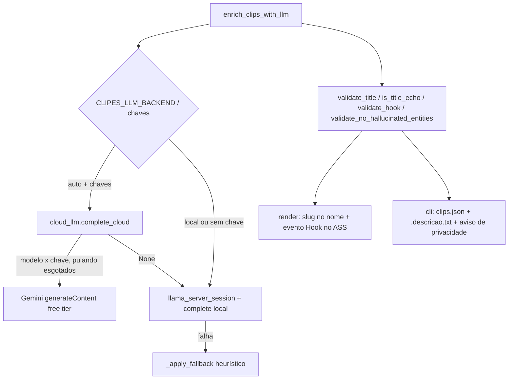

# Onda A Design

**Spec**: `features/clipes-lives/ia-nuvem/issues/onda-a-ia-nuvem-gancho/spec.md`
**Status**: Draft

---

## Architecture Overview

Uma função nova decide o provedor; o resto do fluxo de `enrich_clips_with_llm` continua igual (validação, fallback, desempate). Nenhuma dependência nova: Gemini (free tier) por REST com `urllib`, como o `complete()` local já faz. Nenhum provedor pago (rodada 3).



Ordem dentro de um clipe: nuvem → local → heurística, por clipe. O `llama-server` só sobe se algum clipe cair no local (sessão lazy), para não gastar RAM quando a nuvem responde.

---

## Code Reuse Analysis

### Existing Components to Leverage

| Component | Location | How to Use |
| --------- | -------- | ---------- |
| `complete()` / `CLIP_JSON_SCHEMA` | `clipes/llm.py:289`, `clipes/llm.py:33` | Mesmo schema estendido; payload local inalterado |
| `_THINK_RE`, `_sanitize_prompt_field`, `_build_clip_prompt` | `clipes/llm.py:51`, `:548`, `:554` | Prompt único para todos os provedores |
| `validate_title`, `is_title_echo`, `validate_hook`, `validate_no_hallucinated_entities` | `clipes/llm.py:363-455` | Validam também `gancho_topo` e `descricao_longa` |
| `_apply_fallback`, `format_three_line_caption`, `sanitize_hashtags` | `clipes/llm.py:456-596` | Fallback e descrição determinística |
| `build_ass`, `_ass_escape`, `_ass_time`, constantes `SAFE_MARGIN_*` | `clipes/render.py:14-216` | Novo estilo/evento `Hook` |
| `stem` do render | `clipes/render.py:356` | Passa a incluir o slug |
| Escrita de `.txt` e `clips.json` | `clipes/cli.py:394-427` | Acrescenta `.descricao.txt` e campos |
| Padrão de teste com `urlopen` falso | `tests/test_llm.py` | Mesmo padrão para o Gemini |

### Integration Points

| System | Integration Method |
| ------ | ------------------ |
| Gemini API | `POST https://generativelanguage.googleapis.com/v1beta/models/<modelo>:generateContent`, chave no header `x-goog-api-key` (nunca na URL, para não vazar em log de exceção), `generationConfig.responseMimeType=application/json` + `responseSchema` |
| Contêiner | `docker-compose.yml` repassa as variáveis sem valor (`- GEMINI_API_KEYS`); `clipar` carrega `~/.config/clipes-lives/segredos.env` com `set -a` se existir |

---

## Components

### cloud_llm (novo)

- **Purpose**: Chamar o Gemini free tier em cascata respeitando cotas, devolvendo o dict do schema ou `None`.
- **Location**: `clipes/cloud_llm.py`
- **Interfaces**:
  - `complete_cloud(prompt: str, schema: dict, system_prompt: str, *, urlopen=urllib.request.urlopen, now=time.time) -> tuple[dict, str] | None` - devolve `(resposta, fonte)`, fonte `cloud:gemini:<m>`.
  - `cloud_enabled() -> bool` - `CLIPES_LLM_BACKEND != "local"` e alguma chave definida.
  - `mask(text: str) -> str` - troca qualquer chave conhecida por `***`.
  - `providers_used() -> list[str]` - para a linha de privacidade no README.
- **Dependencies**: stdlib (`urllib`, `json`, `time`, `pathlib`).
- **Reuses**: `_THINK_RE` (import de `llm`); padrão de timeout de `_resolve_timeout`.
- **Estado**: pares que falharam ficam num `set` do módulo, zerado por `reset_round()` no início de `enrich_clips_with_llm`; pares esgotados no dia em `$OUT_DIR/.gemini_cota.json` (`{"dia": "AAAA-MM-DD", "esgotados": ["<modelo>#<k>"]}`, chave pelo índice, nunca o valor), escrita atômica (tmp + replace); intervalo mínimo por chave.

### llm (alterado)

- `CLIP_JSON_SCHEMA` ganha `gancho_topo` (string, maxLength 35) e `descricao_longa` (string, maxLength 500); ambos `required` (uma chamada por clipe cobre itens 5, 6 e 7).
- `_build_clip_prompt` pede título sobre conflito/revelação/reação do trecho (proíbe genéricos e o título do episódio), gancho de topo como pergunta/promessa sem emoji e sem entregar o desfecho, descrição de 2 a 4 frases (150-500, sem URL).
- `enrich_clips_with_llm`: por clipe, `complete_cloud` primeiro; `None` → sessão local lazy → heurística. Novos campos validados e gravados em `clip.hook_top`, `clip.description_long`, `clip.description_source`.
- `long_paragraph_fallback(clip) -> str` (primeiras frases completas, <= 320) e `format_long_description(title, paragraph, channel, url, hashtags, part_index, part_total) -> str` (composição final).

### render (alterado)

- `slugify(title: str, max_len: int = 40) -> str` (stdlib `unicodedata`).
- `clip_stem(idx, clip) -> str` usado por `render_clip` e pelo `--skip-render` do cli (um lugar só para o nome).
- `wrap_top_hook(text, max_chars=18, max_lines=2) -> str` (caixa alta, `_ass_escape`, linha 1 branca, linha 2 amarela, `\N`).
- `build_ass(..., hook_top: str = "")` ganha `Style: TopHook,DejaVu Sans,64,...,Outline 6,Shadow 3,Alignment 5` e evento layer 3 de 0 a `min(5, content_dur)` com `\an5\pos(540,365)\fad(120,350)` e pop `\fscx75\fscy75\t(0,220,\fscx106\fscy106)\t(220,320,\fscx100\fscy100)`.

### models (alterado)

- `SnappedClip` ganha `hook_top: str = ""`, `description_long: str = ""`, `description_source: str = ""`.

---

## Data Models

```python
# clips.json, por clipe (campos novos)
{
  "clip_id": "UBv07VGeD24_c03",
  "file": "clip_03_ele-nao-acreditou-no-que-viu.mp4",
  "title_source": "cloud:gemini:<modelo>",   # ou llm, heuristic_fallback
  "hook_top": "Ele perdeu tudo?",
  "description_long": "twitch.tv/canal ...",
  "description_source": "llm" | "fallback"
}
# README.md da rodada: "Texto da transcrição enviado a: gemini" (só quando houve nuvem)
```

---

## Error Handling Strategy

| Error Scenario | Handling | User Impact |
| -------------- | -------- | ----------- |
| 429 / 5xx / timeout no Gemini | Marca o par como falho na rodada, tenta o próximo | Nenhum; log `[llm] gemini <modelo> chave#k falhou (429)` |
| JSON inválido ou fora do schema | Mesmo que acima | Nenhum |
| 429 `RESOURCE_EXHAUSTED` (cota diária) | Par esgotado até a virada; todos esgotados → local sem rede | Log 1x por rodada |
| `.gemini_cota.json` corrompido | Trata como vazio e reescreve | Aviso no log |
| Sem rede | Todos os pares falham rápido (timeout curto `CLIPES_CLOUD_TIMEOUT=20`) → local | Rodada mais lenta, sem erro |
| Exceção com chave na mensagem | `mask()` antes de logar | Chave nunca aparece |

---

## Risks & Concerns

| Concern | Location (file:line) | Impact | Mitigation |
| ------- | -------------------- | ------ | ---------- |
| Transcrição enviada a terceiros (privacidade) | `clipes/llm.py:554` | Fala dos streamers sai da máquina | Nuvem só com chave + backend != local; aviso no README; nova AD-008 |
| `complete()` sobe `llama-server` por chamada sem sessão | `clipes/llm.py:296` | RAM/tempo | Sessão lazy única por rodada em `enrich_clips_with_llm` |
| `render.py` importado por `llm.py` (`generate_title`) e vice-versa se o slug for para llm | `clipes/llm.py:21` | Import circular | `slugify` fica em `render.py`; `llm.py` não importa nada novo de `render` |
| Nomes de modelo do Gemini mudam | `clipes/cloud_llm.py` | 404 em produção | Lista em env `CLIPES_GEMINI_MODELS`; 404 conta como falha do par e segue |
| Gancho sobre o selo/crédito (y=490/600) ou sob a UI do TikTok (0..240) | `clipes/render.py:146-165` | Sobreposição visual | Centro em y=365, 2 linhas de fonte 64 (~150 px) → faixa 290..440 |
| Gemini Free Tier pode usar o texto para treinar | `clipes/cloud_llm.py` | Privacidade | AD-008 registra; usuário pode ligar billing (Paid Tier) ou usar `CLIPES_LLM_BACKEND=local` |
| LiveCliper sem licença | - | Risco autoral | Só ideias (cascata, gancho, pop); nenhum código copiado |
| Testes do LLM real flaky sob carga | `tests/test_llm_integration.py` | Gate instável | Fora da suíte padrão (como hoje); tudo com fakes |

---

## Tech Decisions (only non-obvious ones)

| Decision | Choice | Rationale |
| -------- | ------ | --------- |
| SDK x REST | REST com `urllib` | 2 endpoints, zero dependência, sem rebuild da imagem |
| Chave no header | `x-goog-api-key` em vez de `?key=` | URL aparece em traceback/log |
| Custo | Só Gemini free tier + Qwen local | Rodada 3: nada pago |
| Projeto-level | AD-008 (nuvem com fallback local) em `STATE.md` | Reverte "100% local" |
