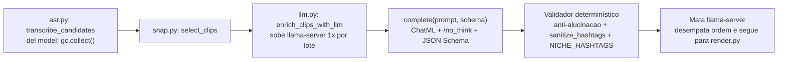

# legenda-hashtags Design

**Spec**: `/home/romulo/Projetos/planos_tlc-spec-driven/clipes-lives/features/clipes-lives/legenda-hashtags/spec.md`
**Status**: Approved

---

## Architecture Overview

### Exploração de Abordagens (Large/Complex)

1. **Abordagem A (Recomendada — Ponytail): Subprocesso `llama-server` (`/opt/llama/llama-server`) uma vez por lote + `urllib.request` stdlib + função pura `complete(prompt, schema) -> dict` em `clipes/llm.py`**
   - Usa o binário estático `llama-server` b12470 já assado em `/opt/llama`, carrega o modelo de `CLIPES_LLM_GGUF` uma única vez após o ASR (amortizando os ~10–15s de mmap page-in), força gramática JSON via `response_format` nativo do `llama-server`, e desliga o processo no `finally`. Zero pacotes pip novos.
2. **Abordagem B: Chamar `llama-cli` um subprocesso por clipe**
   - Rejeitada: recarrega o GGUF de 1,1–2,5 GB a cada clipe (8 × 15s = 2 minutos perdidos só em carga de modelo).
3. **Abordagem C: `llama-cpp-python` in-process**
   - Rejeitada: falhou ao compilar wheel na imagem Debian slim (CONSOLIDADO §3) e dificulta devolver 100% da RAM do processo ao SO antes do `ffmpeg`.



---

## Code Reuse Analysis

### Existing Components to Leverage

| Component | Location | How to Use |
| --------- | -------- | ---------- |
| `generate_title` | `clipes/render.py:20` | Reusar como fallback imediato quando o título do LLM falhar no filtro anti-alucinação ou quando `--no-llm` estiver ativo |
| `SnappedClip`, `IngestResult` | `clipes/models.py:33,71` | Adicionar campos `caption`, `hashtags`, `llm_score`, `llm_reason` em `SnappedClip` com defaults vazios |
| Variáveis de ambiente do `Dockerfile` | `Dockerfile:11,14,15` | Ler `CLIPES_LLM_GGUF`, `CLIPES_CPU_THREADS` e `/opt/llama/llama-server` no `PATH` |

### Integration Points

| System | Integration Method |
| ------ | ------------------ |
| `clipes/asr.py` | `del model; gc.collect()` logo após o loop de janelas em `transcribe_candidates` |
| `clipes/cli.py` | Chamar `enrich_clips_with_llm(clips, words, ing, enabled=not args.no_llm)` entre `select_clips` e o loop de `render_clip` (tarefa final sincronizada após a série de `cli.py`) |

---

## Components

### 1. Descarte Explícito do Whisper (`clipes/asr.py`)

- **Purpose**: Garantir que os ~1,6 GB (ou ~3,1 GB do turbo) do CTranslate2 sejam liberados antes de qualquer chamada ao LLM.
- **Location**: `clipes/asr.py`
- **Interfaces**: Internamente em `transcribe_candidates`: `del model; gc.collect()`.

### 2. Cliente `llama-server` e Validador de Metadados (`clipes/llm.py`)

- **Purpose**: Gerar e validar título, legenda de 3 linhas, 3–5 hashtags e nota 0–10 por clipe sem abstrações desnecessárias.
- **Location**: `clipes/llm.py`
- **Interfaces**:
  - `complete(prompt: str, schema: dict[str, Any] = CLIP_JSON_SCHEMA, server_url: str | None = None, timeout: float = 45.0) -> dict[str, Any]`
  - `validate_no_hallucinated_entities(title: str, transcript: str, reference_text: str = "") -> bool`
  - `sanitize_hashtags(raw_tags: list[str], channel: str = "", title: str = "") -> list[str]`
  - `format_three_line_caption(hook: str, channel: str, url: str, hashtags: list[str], part_index: int = 1, part_total: int = 1) -> str`
  - `enrich_clips_with_llm(clips: list[SnappedClip], words: list[Word], ing: IngestResult, enabled: bool = True) -> None`
- **Dependencies**: `subprocess`, `urllib.request`, `json`, `re`, `unicodedata`, `gc` (stdlib)
- **Reuses**: `generate_title` de `clipes/render.py`

---

## Data Models

### Schema JSON exigido pela gramática do `llama-server` (`CLIP_JSON_SCHEMA`)
```json
{
  "type": "object",
  "properties": {
    "titulo": {"type": "string", "maxLength": 60},
    "gancho": {"type": "string", "maxLength": 140},
    "hashtags": {
      "type": "array",
      "items": {"type": "string"},
      "minItems": 3,
      "maxItems": 5
    },
    "nota": {"type": "number", "minimum": 0, "maximum": 10},
    "motivo": {"type": "string", "maxLength": 120}
  },
  "required": ["titulo", "gancho", "hashtags", "nota", "motivo"],
  "additionalProperties": false
}
```

### Banco de Hashtags Determinístico (`NICHE_HASHTAGS`)
Dicionário compacto em `clipes/llm.py` mapeando palavras-chave de canal/título (ex.: `podpah`, `flow`, `gaules`, `cs2`, `counter-strike`, `gta`, `rp`, `valorant`, `lol`, `minecraft`, `react`, `podcast`) para hashtags limpas (`#podpah`, `#flowpodcast`, `#gaules`, `#cs2br`, `#gtarp`, `#valorantbr`, `#cortes`, `#livesbr`).

---

## Error Handling Strategy

| Error Scenario | Handling | User Impact |
| -------------- | -------- | ----------- |
| `Qwen3-1.7B` inventa nome próprio no título (ex.: `"moto do Professor"`) | `validate_no_hallucinated_entities` detecta `"Professor"` ausente da transcrição/título original e substitui pelo `generate_title(clip, words)` | Zero títulos alucinados no manifesto |
| LLM gera hashtag com hífen (`#gta-rp`) ou proibida (`#fyp`, `#viral`) | `sanitize_hashtags` remove hífens (`#gtarp`), filtra `FORBIDDEN_HASHTAGS` e completa até 3–5 itens com `NICHE_HASHTAGS` | Sempre entrega 3–5 hashtags válidas |
| Timeout ou crash do `llama-server` | `enrich_clips_with_llm` captura a exceção, mata o processo e preenche os clipes restantes com fallback determinístico | Pipeline termina com código `0` e gera todos os MP4s |

---

## Risks & Concerns

| Concern | Location (file:line) | Impact | Mitigation |
| ------- | -------------------- | ------ | ---------- |
| Qwen3 gasta tokens em `<think>` ou retorna `{""}` se chamado sem ChatML + `/no_think` | `clipes/llm.py` | Timeout ou campos vazios (medido em `C-credito-modelos-argon.md` §2a) | Passar `--reasoning-budget 0` ao `llama-server` e incluir `/no_think` no prompt |
| `docker-compose.yml` com `mem_limit: 8g` em host de 9 GB RAM | `docker-compose.yml:6` | Com o modelo 4B (~4,5 GB RSS), `8g` deixa só ~1 GB para o SO do host; com o 1.7B padrão (~2 GB RSS), `6g` basta (CONSOLIDADO §6.5) | Manter 1.7B como padrão (pico <= 2,5 GB) e documentar o alerta para confirmação do usuário |
| Conflito de edição em `cli.py` com as features em série (1, 4, 5) | `clipes/cli.py:183-221` | Merge conflict se editado ao mesmo tempo | Isolar toda a lógica em `clipes/llm.py` (T2–T4) e deixar o toque de 8 linhas em `clipes/cli.py` (T5) sincronizado após as features em série |

---

## Tech Decisions

| Decision | Choice | Rationale |
| -------- | ------ | --------- |
| Comunicação com `llama.cpp` | `llama-server` HTTP local (`127.0.0.1`) via `urllib.request` | Sobe o GGUF uma única vez por lote, suporta JSON Schema nativo e encerra liberando toda a RAM ao SO |
| Papel da `nota` (0–10) do LLM | Apenas desempate relativo (`score` principal continua dos sinais) | Os 5 LLMs deram 7–9 para o mesmo trecho e o paper Rhapsody mostra que LLM zero-shot empata com o acaso (CONSOLIDADO §3) |
