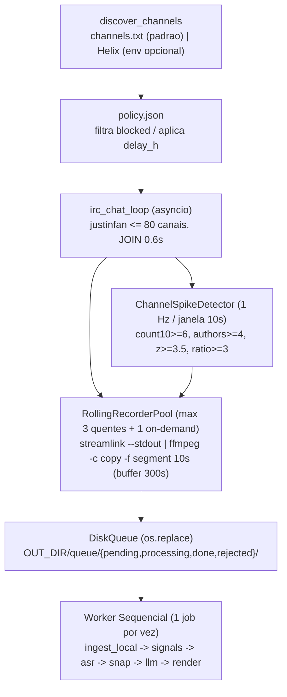

# monitor-twitch Design

**Spec**: `/home/romulo/Projetos/planos_tlc-spec-driven/clipes-lives/features/clipes-lives/monitor-twitch/spec.md`
**Status**: Approved

---

## Architecture Overview

### Exploração de Abordagens (Large/Complex)

1. **Abordagem A (Recomendada — Ponytail): Módulo único `clipes/monitor.py` (`asyncio` stdlib + `streamlink|ffmpeg` subprocess + fila em diretórios JSON com `os.replace`)**
   - Zero banco de dados, zero biblioteca de IRC externa (protocolo IRC de leitura com tags leva ~70 linhas de `asyncio.open_connection`), `urllib.request` stdlib para Helix opcional, e `streamlink` adicionado apenas no `Dockerfile`.
2. **Abordagem B: Usar `twitchio` / `irc` + `celery` / `redis` para fila**
   - Rejeitada: adiciona múltiplos serviços/containers e dependências desnecessárias para uma fila local de 1 worker.
3. **Abordagem C: Gravar com `yt-dlp` ou usar `Create Clip API`**
   - Rejeitada: `yt-dlp` não filtra anúncios na Twitch ao vivo, e `Create Clip` exige token de usuário `clips:edit` e corta em <= 60s (CONSOLIDADO §4).



---

## Code Reuse Analysis

### Existing Components to Leverage

| Component | Location | How to Use |
| --------- | -------- | ---------- |
| `BOT_AUTHORS`, `_compact_chat_rows`, `extract_wav`, `probe_duration` | `clipes/ingest.py:17,69,44,231` | Reusar diretamente para filtrar bots no IRC, compactar `chat.json` do job e extrair `audio.wav` de `source.mkv` em `ingest_local` |
| `signal_chat` | `clipes/signals.py:150` | Lê o `chat.json` salvo pelo monitor no exato formato `[t_rel, texto, autor_idx]` sem nenhuma adaptação |
| `run_pipeline` | `clipes/cli.py:79` | Reusar para processar cada job da fila passando o diretório local ingerido |

### Integration Points

| System | Integration Method |
| ------ | ------------------ |
| `clipes/ingest.py` | Nova função `ingest_local(local_dir: Path, out_root: Path) -> IngestResult` que monta `IngestResult` a partir de `source.mkv`, `meta.json` e `chat.json` sem chamar `yt-dlp` |
| `Dockerfile` | Adicionar `"streamlink>=6.7.0"` ao `pip install` na linha 34 |

---

## Components

### 1. Ingestão de Arquivo Local (`clipes/ingest.py`)

- **Purpose**: Permitir que o pipeline processe uma gravação já capturada pelo monitor (`source.mkv` + `meta.json` + `chat.json`) sem acessar a rede via `yt-dlp`.
- **Location**: `clipes/ingest.py`
- **Interfaces**:
  - `ingest_local(local_dir: Path, out_root: Path, enable_chat: bool = True) -> IngestResult`
- **Dependencies**: `extract_wav`, `probe_duration`
- **Reuses**: `IngestResult` de `clipes/models.py`

### 2. Descoberta e Política por Canal (`clipes/monitor.py`)

- **Purpose**: Resolver a lista de até 80 canais ativos respeitando `policy.json` (`blocked`, `allowed`, `delay_h`).
- **Location**: `clipes/monitor.py`
- **Interfaces**:
  - `ChannelPolicy(blocked: set[str], allowed: set[str], delay_h: dict[str, float])`
  - `load_policy(path: Path | None) -> ChannelPolicy`
  - `discover_channels(channels_file: Path, policy: ChannelPolicy, game_id: str | None = None, limit: int = 80) -> list[str]`
- **Dependencies**: `urllib.request`, `json`, `os` (stdlib)
- **Reuses**: `sanitize_id` de `clipes/ingest.py`

### 3. Cliente IRC Anônimo e Detector de Pico Relativo (`clipes/monitor.py`)

- **Purpose**: Ler mensagens em tempo real via IRC `justinfan` e disparar eventos quando o chat apresentar anomalia estatística relativa ao próprio canal.
- **Location**: `clipes/monitor.py`
- **Interfaces**:
  - `parse_irc_line(line: str) -> tuple[dict[str, str], str, str, str] | None` (retorna `tags, channel, author, text`; ignora se `tags.get("source-room-id")` existir e diferir de `tags.get("room-id")`)
  - `ChannelSpikeDetector.record_message(t: float, author: str, text: str) -> None`
  - `ChannelSpikeDetector.check_spike(now: float) -> SpikeEvent | None`
- **Dependencies**: `asyncio`, `collections.deque`, `math`, `numpy`
- **Reuses**: `BOT_AUTHORS` de `clipes/ingest.py`, fórmula Poisson de `clipes/signals.py:218`

### 4. Pool de Gravação em Buffer Rolante (`clipes/monitor.py`)

- **Purpose**: Manter `streamlink | ffmpeg -c copy` nos até 3 canais mais ativos + 1 slot sob demanda e consolidar `[T_pico - 180s, T_pico + pos_roll]` em `source.mkv`.
- **Location**: `clipes/monitor.py`
- **Interfaces**:
  - `RollingRecorderPool(buf_root: Path, max_hot: int = 3, max_on_demand: int = 1, buffer_seconds: int = 300)`
  - `freeze_and_concat(channel: str, start_ts: float, end_ts: float, dst_mkv: Path) -> Path`
- **Dependencies**: `subprocess`, `shutil`, `streamlink`, `ffmpeg`
- **Reuses**: `_compact_chat_rows` de `clipes/ingest.py`

### 5. Fila Atômica em Disco e Worker Sequencial (`clipes/monitor.py`)

- **Purpose**: Persistir jobs em `OUT_DIR/queue/{pending,processing,done,rejected}/` via `os.replace` e processar 1 job por vez.
- **Location**: `clipes/monitor.py`
- **Interfaces**:
  - `DiskQueue(queue_root: Path)`: `enqueue(job_dir)`, `claim_next() -> Path | None`, `complete(job_dir, status, manifest)`, `recover_orphans()`
  - `run_worker_step(queue: DiskQueue, out_root: Path, policy: ChannelPolicy) -> bool`
- **Dependencies**: `pathlib`, `os.replace`, `json`
- **Reuses**: `run_pipeline` de `clipes/cli.py`

---

## Data Models

Formato de `OUT_DIR/queue/<state>/<job_id>/job.json`:
```json
{
  "job_id": "gaules_1763380000",
  "channel": "gaules",
  "url": "https://www.twitch.tv/gaules",
  "peak_ts": 1763380000.0,
  "peak_rel_s": 178.4,
  "count10": 42,
  "unique_authors10": 31,
  "expected10": 8.5,
  "z_score": 10.85,
  "partial_preroll": false,
  "created_at": 1763380095.0,
  "ready_at": 1763466495.0,
  "score": 0.884,
  "status": "done"
}
```

---

## Error Handling Strategy

| Error Scenario | Handling | User Impact |
| -------------- | -------- | ----------- |
| Desconexão do socket IRC ou timeout de PING/PONG | Reconecta automaticamente com backoff `1s, 2s, 4s...` até `60s` e re-envia `JOIN` a `0.6s`/canal | Monitor continua sem intervenção manual |
| Anúncio mid-roll na Twitch durante gravação | `streamlink` pausa a saída durante o anúncio; `ffmpeg` usa `-reset_timestamps 1` nos segmentos `.ts` | Pequena descontinuidade no corte bruto, sem travar o gravador |
| Crash do container com job em `processing/` | `DiskQueue.recover_orphans()` move qualquer pasta de `processing/` de volta para `pending/` no início | Nenhum job é perdido |

---

## Risks & Concerns

| Concern | Location (file:line) | Impact | Mitigation |
| ------- | -------------------- | ------ | ---------- |
| Termos de Serviço da Twitch sobre gravação automatizada e direitos de streamer | `clipes/monitor.py` | Risco de bloqueio de IP ou reivindicação de direitos (CONSOLIDADO §6.1) | O monitor **não publica**; aplica `policy.json` (`blocked`, `allowed`, `delay_h`), limita a 3+1 streams e apaga o buffer rolante em 5 min |
| IRC `justinfan` não é documentado oficialmente | `clipes/monitor.py` | Pode sofrer rate limit se passar de 100 canais ou 20 JOINs/10s (CONSOLIDADO §4 e §6.3) | Trava dura em `MAX_CHANNELS = 80` e `JOIN_INTERVAL_S = 0.65` |
| Estouro de disco se a limpeza de segmentos falhar | `clipes/monitor.py` | Segmentos `.ts` acumulariam ~1,8 GB/h por canal | Varredura de limpeza a cada 10s removendo `.ts` com `mtime < now - 300s` e teto global de 1,5 GB para `/out/queue/.buffer` |

---

## Tech Decisions

| Decision | Choice | Rationale |
| -------- | ------ | --------- |
| Cliente IRC | `asyncio.open_connection` puro em Python stdlib | Protocolo de leitura `PRIVMSG` + `PING/PONG` + `CAP REQ :twitch.tv/tags` tem ~70 linhas; evita dependências externas |
| Fila de jobs | Diretórios POSIX (`pending`, `processing`, `done`, `rejected`) + `os.replace` | Atômico no mesmo filesystem, inspecionável com `ls`/`cat`, zero banco de dados |
