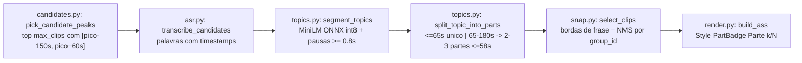

# partes-por-assunto Design

**Spec**: `/home/romulo/Projetos/planos_tlc-spec-driven/clipes-lives/features/clipes-lives/partes-por-assunto/spec.md`
**Status**: Approved

---

## Architecture Overview

### Exploração de Abordagens (Large/Complex)

1. **Abordagem A (Recomendada — Ponytail): `onnxruntime` + `tokenizers` direto sobre frases do Whisper + régua determinística de partes (`clipes/topics.py`)**
   - Usa as bibliotecas `onnxruntime` e `tokenizers` que **já estão instaladas** na imagem Docker como dependências de `faster-whisper` e carrega `/opt/models/embed/onnx/model_quint8_avx2.onnx` (`CLIPES_EMBED_ONNX`). Zero pacotes pip novos, ~80 linhas em `clipes/topics.py`, `< 2s` de CPU por janela de 3 min.
2. **Abordagem B: Instalar `sentence-transformers` / `torch` / `fastembed`**
   - Rejeitada: puxa PyTorch ou dependências pesadas (> 1,5 GB de imagem extra), violando o estilo ponytail e o piso de RAM.
3. **Abordagem C: TextTiling puramente léxico (bag-of-words sem modelo)**
   - Rejeitada como primária: medido no relatório `C-credito-modelos-argon.md` que o TextTiling léxico puro falhou (0/2 fronteiras) em fala coloquial de live pt-BR porque os falantes mudam de assunto sem repetir substantivos. Mantida apenas como fallback se o ONNX falhar.



---

## Code Reuse Analysis

### Existing Components to Leverage

| Component | Location | How to Use |
| --------- | -------- | ---------- |
| `Word.ends_sentence` | `clipes/models.py:25` | Reusar para agrupar palavras em frases e validar cortes entre partes |
| `CandidatePeak`, `SnappedClip` | `clipes/models.py:60-92` | Estender com campos opcionais com valor default (`part_index=1`, `part_total=1`, `group_id=""`) mantendo retrocompatibilidade |
| `merge_windows` | `clipes/asr.py:17` | Já funde janelas `[pico-150s, pico+60s]` sobrepostas automaticamente antes do Whisper |
| `_speech_start_candidates`, `_speech_end_candidates`, `_extend_past_reaction` | `clipes/snap.py:54-201` | Reusar na escolha fina de bordas de frase e proteção de risada pós-fala no fim de cada parte |
| `build_ass` | `clipes/render.py:92` | Adicionar estilo `PartBadge` e evento `Dialogue` quando `part_total > 1` |

### Integration Points

| System | Integration Method |
| ------ | ------------------ |
| Modelo MiniLM ONNX assado na imagem | Lido de `os.environ.get("CLIPES_EMBED_ONNX", "/opt/models/embed/onnx/model_quint8_avx2.onnx")` e `tokenizer.json` no mesmo diretório pai |
| Feature `creditos-encerramento` (série) | Compartilha `SnappedClip.part_index` / `part_total` para decidir se o cartão final de `1.2s` exibe `"Parte k+1 →"` ou `"Live completa: ..."` |

---

## Components

### 1. Extensão de Modelos (`clipes/models.py`)

- **Purpose**: Representar segmentos de assunto e partes numeradas de um clipe sem quebrar chamadas existentes.
- **Location**: `clipes/models.py`
- **Interfaces**:
  - `TopicSegment(start: float, end: float, peak: float, sentences: list[tuple[float, float, str]], boundary_score: float = 0.0)`
  - `SnappedClip`: novos campos com default `part_index: int = 1`, `part_total: int = 1`, `group_id: str = ""`
- **Dependencies**: `dataclasses` (stdlib)
- **Reuses**: `Word`, `CandidatePeak`, `SnappedClip`

### 2. Janela Assimétrica nos Candidatos (`clipes/candidates.py`)

- **Purpose**: Ampliar a janela de transcrição dos top `max_clips` candidatos para `[pico - 150s, pico + 60s]`.
- **Location**: `clipes/candidates.py`
- **Interfaces**:
  - `pick_candidate_peaks(bundle, max_clips=8, min_separation=90, window_half=45.0, pre_window=150.0, post_window=60.0, signal_fire_threshold=0.35) -> list[CandidatePeak]`
  - Para os primeiros `max_clips` candidatos ordenados por `raw_score`, usa `start_win = max(0.0, p - pre_window)` e `end_win = min(bundle.duration, p + post_window)`; para os reservas (`max_clips .. 2*max_clips`), mantém `window_half` (`45.0s`) para não inflar o tempo de ASR.
- **Dependencies**: `numpy`, `scipy.signal.find_peaks`
- **Reuses**: lógica atual de `pick_candidate_peaks`

### 3. Segmentador Semântico e Divisor de Partes (`clipes/topics.py`)

- **Purpose**: Agrupar palavras em frases, detectar fronteiras de assunto ao redor do pico via MiniLM ONNX int8 + pausas, e fatiar assuntos longos em 2–3 partes de `45–58s`.
- **Location**: `clipes/topics.py`
- **Interfaces**:
  - `words_to_sentences(words: list[Word], pause_split: float = 0.8) -> list[tuple[float, float, str]]`
  - `embed_sentences(texts: list[str], onnx_path: str | None = None) -> np.ndarray | None` (mean pooling mascarado + normalização L2 via `onnxruntime.InferenceSession` e `tokenizers.Tokenizer`)
  - `segment_topics(words: list[Word], peak: float, max_topic_dur: float = 180.0, onnx_path: str | None = None) -> TopicSegment | None`
  - `split_topic_into_parts(topic: TopicSegment, words: list[Word], min_dur: float = 25.0, single_max_dur: float = 65.0, part_max_dur: float = 58.0) -> list[tuple[float, float, int, int]]`
- **Dependencies**: `onnxruntime`, `tokenizers`, `numpy` (já instalados no container via `faster-whisper`)
- **Reuses**: `Word.ends_sentence` de `clipes/models.py`

### 4. Snapping Ancorado no Assunto (`clipes/snap.py`)

- **Purpose**: Ajustar cada parte/assunto às melhores bordas de frase e risada pós-fala sem forçar `PEAK_POS_MIN/MAX = 0.35/0.75` quando delimitado por assunto.
- **Location**: `clipes/snap.py`
- **Interfaces**:
  - `snap_topic_parts(candidate: CandidatePeak, words: list[Word], rms_db: np.ndarray, duration: float, min_dur: float = 25.0, single_max_dur: float = 65.0, part_max_dur: float = 58.0, bundle: SignalBundle | None = None) -> list[SnappedClip]`
  - `select_clips(...) -> list[SnappedClip]`: preserva todas as partes de um mesmo `group_id` juntas, garantindo que a lista final não trunque uma série na metade.
- **Dependencies**: `clipes/topics.py`, `clipes/models.py`
- **Reuses**: `_extend_past_reaction`, `_cuts_mid_word`, `_speech_start_candidates`, `_speech_end_candidates`

### 5. Selo de Parte no ASS e Manifesto (`clipes/render.py`, `clipes/eval.py`, `clipes/cli.py`)

- **Purpose**: Queimar `Parte k/N` no topo seguro do vídeo quando `part_total > 1` e expor os campos no `clips.json`.
- **Location**: `clipes/render.py`, `clipes/eval.py`, `clipes/cli.py`
- **Interfaces**:
  - `build_ass(..., part_index: int = 1, part_total: int = 1) -> int`
  - Em `eval.py`: `evaluate_clips` valida `d <= 58.0` quando `c.part_total > 1` e `d <= max_dur` (`65.0`) quando `c.part_total == 1`; `peak_position_ok_rate` considera válidos os clipes com `edge_mode == "topic"`.

---

## Data Models

```python
@dataclass
class TopicSegment:
    start: float
    end: float
    peak: float
    sentences: list[tuple[float, float, str]]
    boundary_score: float = 0.0

    @property
    def duration(self) -> float:
        return round(self.end - self.start, 3)
```

Campos adicionados a `SnappedClip` (`clipes/models.py`):
```python
    part_index: int = 1
    part_total: int = 1
    group_id: str = ""
```

---

## Error Handling Strategy

| Error Scenario | Handling | User Impact |
| -------------- | -------- | ----------- |
| Modelo ONNX ausente ou erro no `onnxruntime` | Captura `Exception`, imprime `[topics] MiniLM ONNX indisponível, usando fallback de pausa/frase` e segmenta por `gap >= 0.8s` + `ends_sentence` | Pipeline continua normalmente sem abortar |
| Assunto longo sem borda de frase válida para divisão em partes `<= 58s` | Descarta a divisão multi-parte e recai para o `snap_candidate` de clipe único (`25–65s`) ao redor do pico | Gera 1 clipe válido em vez de partes quebradas |
| Série multi-parte estouraria `max_clips` pela metade | Se `len(chosen) + len(parts) > max_clips + 1`, encerra ou aceita a série inteira se `len(chosen) < max_clips` | Nunca publica `Parte 1/2` órfã sem `Parte 2/2` |

---

## Risks & Concerns

| Concern | Location (file:line) | Impact | Mitigation |
| ------- | -------------------- | ------ | ---------- |
| `PEAK_POS_MIN/MAX = 0.35/0.75` hardcoded em `snap.py:16-17,312,334` e `eval.py:57` | `clipes/snap.py:312`, `clipes/eval.py:57` | Descartaria assuntos onde a punchline fica no fim (`ratio ~ 0.85`) ou marcaria falha em `peak_position_ok_rate` | Em `snap_topic_parts`, definir `edge_mode = "topic"` e dispensar a trava `[0.35, 0.75]` quando as bordas vierem de frases do assunto; atualizar `eval.py` para aceitar `edge_mode == "topic"` |
| Aumento do tempo de ASR com janela de 210s | `clipes/candidates.py:57` | 16 candidatos × 210s dobraria o áudio transcrito | Aplicar a janela de 210s (`[pico-150s, pico+60s]`) **apenas** nos top `max_clips` (8) candidatos; manter `±45s` nos reservas |
| RetençãoSimultânea da sessão ONNX na RAM | `clipes/topics.py` | Sessão ONNX ocupa ~200–400 MB | Instanciar `InferenceSession` apenas durante `segment_topics` e liberar antes de iniciar o LLM |

---

## Tech Decisions

| Decision | Choice | Rationale |
| -------- | ------ | --------- |
| Runtime de embeddings | `onnxruntime` + `tokenizers` direto sobre `/opt/models/embed/onnx/model_quint8_avx2.onnx` | Já instalados no container via `faster-whisper`; zero dependências novas (ponytail) |
| Teto de conteúdo por parte | `58.0s` (multi-parte) e `65.0s` (clipe único) | `58.0s + 1.2s` de cartão final = `59.2s <= 60.0s`, evitando bloqueio global de Shorts `> 1 min` com claim musical |
